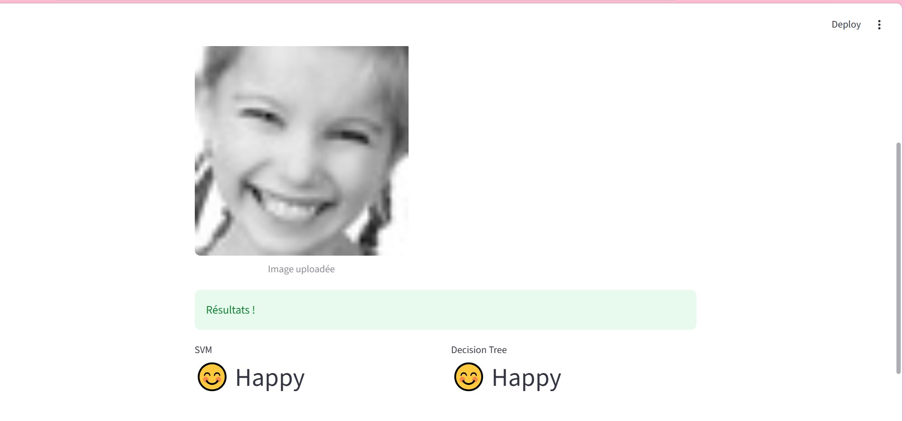
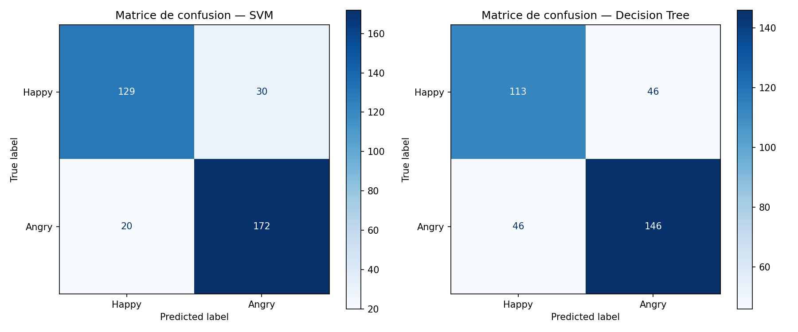

# Facial Emotion Recognition with CNN Feature Extraction

Binary facial emotion recognition (**Happy** vs **Angry**) that uses three pre-trained CNNs as frozen feature extractors and compares two classical classifiers (SVM and Decision Tree) on the extracted features. Includes a Streamlit upload app and a real-time webcam demo.

Project developed at EMSI (class 4IASDR3, 2025–2026), supervised by Mme Mounia Aarich.



## Pipeline

```
Images → Preprocessing → VGG16 + ResNet50 + AlexNet → Concatenation (31,232 features)
       → SelectKBest (1,000 features) → SVM / Decision Tree → Prediction
```

| Extractor | Framework | Features |
|---|---|---|
| VGG16 | Keras | 25,088 |
| ResNet50 | Keras | 2,048 |
| AlexNet | PyTorch | 4,096 |

- The CNNs are used **without fine-tuning**: classification layers are removed and the outputs are concatenated into one 31,232-dimensional vector.
- **Preprocessing**: BGR→RGB, resize to 224×224 (227×227 for AlexNet), scale to [0, 1], ImageNet standardization.
- **Feature selection**: `SelectKBest` (ANOVA F-test) keeps the 1,000 most discriminative features.
- **Classifiers**: SVM (RBF kernel, C=10, `class_weight="balanced"`, `StandardScaler`) and Decision Tree (max depth 10).
- **Split**: 80% train / 20% test, stratified.

## Results

Test set: 351 images (159 Happy, 192 Angry).

| Model | Accuracy | F1 (macro) |
|---|---|---|
| SVM (RBF) | 85.8% | 0.855 |
| Decision Tree | 73.8% | 0.736 |



The SVM generalizes better in this setup; the Decision Tree is less accurate but easier to interpret.

## Demos

- **Streamlit app** (`app.py`): upload a face image and get both classifiers' predictions.
- **Real-time** (`realtime.py`): webcam capture with Haar Cascade face detection. Display (~30 FPS) and prediction (~6–7 FPS) run in separate threads to keep the video smooth.

## Dataset

1,754 face images: 796 Happy and 958 Angry. **[Add dataset name and link here.]** The images are not included in this repository.

## Project structure

| File | Role |
|---|---|
| `load_data.py`, `preprocess.py` | Image loading and preprocessing |
| `extract_features.py` | Feature extraction with the three CNNs |
| `concatenate_features.py` | Concatenation of the feature vectors |
| `select_features.py` | Feature selection (SelectKBest) |
| `classify.py` | Training and evaluation of SVM and Decision Tree |
| `main.py` | Runs the full training pipeline |
| `app.py` | Streamlit interface |
| `realtime.py` | Real-time webcam demo |

## Getting started

```bash
pip install -r requirements.txt
```

1. Put the dataset in a folder named `HA/` next to the scripts (one subfolder per class).
2. Train: `python main.py` (trained models are saved to `models/`, which is not included in the repo).
3. Run the app: `streamlit run app.py`
4. Real-time demo: `python realtime.py`

## Limitations and next steps

- Binary task (2 emotions) on a small dataset; a single train/test split, no cross-validation
- Feature selection is applied before the train/test split, which can slightly inflate the reported scores; fitting it on the training set only (e.g., with a scikit-learn `Pipeline`) would be cleaner
- CNNs are used as frozen extractors; fine-tuning or a fully connected head could improve results
- Extension to 7 emotions (FER2013), and more robust face detection (MTCNN, RetinaFace)

## Authors

Chaymae Yassine and Bassma Chemaou El Fihri, EMSI Rabat
